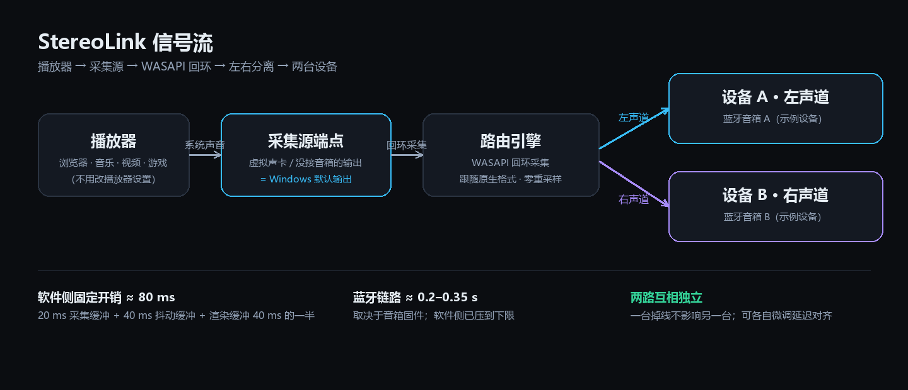

# StereoLink 立体声链


源码仓库：<https://github.com/wakewow/stereo-link>

把本机播放设备组合成一对左右声道：系统声音拆成左 / 右两路，分别推给两台设备（例如两只蓝牙音箱），
同时在面板里实时显示每条链路的状态。




## 这个项目适合谁

**手头有两台以上音频设备（重点是蓝牙音箱），但没法把它们组成立体声的人。**

- 不同品牌 / 不同型号的音箱，根本配不成官方「立体声组合」（TWS 对）；
- 同款音箱能组「立体声组合」，但组队后延迟更高、只能两只一起用、或者必须待在同一间房；
- 想让「一台放左、一台放右」，Windows 自己做不到：系统只能把一条立体声混音送给**一个**输出端点。

StereoLink 补的就是这一块：把系统声音拆成左 / 右两路，分别推给两台（或更多）设备；每路的电平、
发流量、缓冲、欠载实时可见；两路各自独立起流，一台掉线不影响另一台。

- 程序形态：单个 `stereo-link.exe`（EGUI/OpenGL 绘制），没有安装包、没有后台服务、没有网页前端。
- 采集源是**任意一个「不会被听见」的本机输出端点**：虚拟音频设备（自研 StereoLink 虚拟声卡、
  UU远程虚拟音频设备、Steam Streaming），或者一个没接音箱 / 显示器的物理输出（板载 Realtek
  扬声器口、空着的 HDMI / DP）。**零安装即可用**：不用装驱动、不用重启、不用第三方软件。
- 播放器不用单独配置：开始路由时面板把 Windows 默认输出切到采集源，引擎从它的 WASAPI
  回环流里取声；停止或正常退出时切回原来的默认输出（**强杀不会恢复**）。
- 自研虚拟声卡 **StereoLinkVad**（render-only，从 Scream 派生，MS-PL）是**可选的高级路径**：
  机器上一个虚拟音频设备都没有、又不想装第三方软件时，可以用它得到一个只属于 StereoLink 的
  采集端点。安装需要管理员权限、开启测试签名（testsigning）并重启一次，Secure Boot 必须关闭，
  桌面会常驻「测试模式」水印，详见 [`docs/virtual-soundcard.md`](docs/virtual-soundcard.md)。

## 这是什么、怎么工作

```text
        Windows 播放器（浏览器 / 音乐播放器 / 视频 / 游戏 …）
                          │  默认输出 = 采集源
                          ▼
        采集源端点（任选一个「不会被听见」的本机输出）
          ├─ 虚拟音频设备（自研 StereoLink 虚拟声卡 / UU远程 / Steam Streaming）
          └─ 没接音箱的物理输出（板载扬声器口 / 空着的 HDMI、DP）
                          │  WASAPI loopback 采集（原生混音格式）
                          │  本机 48 kHz / 2 ch（原生混音格式，零重采样）
                          ▼
                   StereoLink 路由引擎
                    ├── 左声道 → 设备 A（例如：蓝牙音箱 A）  ≈10 ms 一块
                    └── 右声道 → 设备 B（例如：蓝牙音箱 B）
```

- **左 / 右分离**：左声道整份送给设备 A，右声道整份送给设备 B。两路各自独立起流、独立失败：
  一台设备掉线不影响另一台。
- **任意本机播放设备**：蓝牙音箱、USB 声卡、耳机、HDMI 输出都可以，只要出现在「本机播放设备」
  列表里；左右各选一台即可（引擎本身支持任意多路，也支持「双声道混音」单只音箱听完整节目）。
- **采集源分类提示**：采集源下拉里每个端点都标了类别——`虚拟声卡（无声，推荐）`、
  `物理输出（可能出声）`、`蓝牙音箱（会重复出声，别选）`。选蓝牙音箱会听到两遍声音，
  选已接音箱的物理输出会漏音。
- **自动切默认输出**：开始路由时自动把 Windows 默认输出切到采集源，正常退出时切回原设备；
  面板上也有「切为默认输出 / 恢复原输出」按钮，可关掉自动切换。
- **UU 兜底**：本机既没有虚拟音频设备、也没有空闲物理输出时，面板会提示先运行一次 UU远程
  （免费，会装好一个虚拟音频设备）→ 点「刷新设备」→ 选「扬声器 (UU远程虚拟音频设备)」。
- **播放设备格式设置**：每台设备都可以在面板里直接选采样率 / 位深（44.1 / 48 / 96 kHz，
  16 / 24 / 32 bit）。选中即生效：不用管理员、不用重启音频服务、不写注册表，改完立刻读回校验。
- **实测反馈**：每路实时电平、累计发送量、缓冲、欠载次数；左右自检音；增益、抖动缓冲、左右
  微调延迟都在面板里可调。
- **零重采样（音质）**：引擎采样率自动跟随采集源的原生混音格式（本机 48000 Hz），采集 → 队列
  → 渲染全程同率，不再有固定采样率与设备采样率之间的级联重采样；「路径」列显示 `Auto`（悬停可见完整
  `wasapi-autoconvert（48000 Hz / 2 ch / 16-bit int，零 SRC）`）。实测波形相关系数 1.000000、
  THD 0.001%、0 削顶 / 0 掉块 / 0 突变块、扫频 100 Hz–10 kHz 平坦 +0.0 dB。
- **系统音量联动**：采集源是不吃系统音量的第三方虚拟音频设备（UU远程、Steam 等）时，面板默认
  把采集源的音量 / 静音镜像到两台音箱，拖 Windows 音量条就能控制音箱（策略可切「自动 / 跟随系统
  音量 / 不联动」）；改过的目标设备音量会在停止 / 正常退出时还原。
- **每路反相 180°**：两只音箱接线或单元极性相反、导致居中人声与低音互相抵消时，可为左 / 右
  任一路勾选反相，把极性修回来。
- **声学自校验**：可以用本机麦克风量出两台音箱的真实到达时间差，自动给较慢的一路垫延迟；
  没有麦克风时用「点击串试听」靠人耳手动微调。
- **诊断与日志**：面板内置诊断清单（采集源、默认输出、路由状态等），可一键复制；内嵌日志面板
  方便排障。

## 测试环境与兼容性

本项目**只在这一台机器上完整实测过**；换机型、换蓝牙适配器、换音箱请自行验证。

| 项目 | 本机实测配置 |
| --- | --- |
| 操作系统 | Windows 11 24H2（build 26100.9711，x64）<br>※ 注册表 `ProductName` 仍写 “Windows 10 Pro”，这是 Win11 的已知显示现象 |
| 蓝牙适配器 | Intel(R) Wireless Bluetooth(R)，`USB\VID_8087&PID_0033`，驱动 23.140.0.5，固件 3719a3584001000d19（Intel Wi-Fi 6E AX211 的 CNVi 组合模块） |
| 蓝牙协议 | 经典蓝牙 A2DP（Windows 内置蓝牙栈，SBC 编码）；适配器上报 LMP 13 / 子版本 0x3058（蓝牙 5.4 档位；Intel 对 AX211 标称蓝牙 5.3） |
| 音箱 | 2 × 蓝牙音箱（各自独立 A2DP 连接，**没有组「立体声组合」**；本机实测用的是两台同型号音箱） |
| 采集源 | 「扬声器 (UU远程虚拟音频设备)」（零安装路径）；自研 `StereoLinkVad` 驱动是可选的高级路径 |
| 工具链 | Rust 1.88+（MSVC）、cargo 1.99 |
| 程序形态 | 单个 `stereo-link.exe`（egui / OpenGL），无安装包、无后台服务、无网页前端 |
| 开销 | 面板常驻约 150 MB 内存、约 4.7% 单核（可见时；最小化后更低） |

**兼容性提醒**

- 微软官方文档称「一个蓝牙适配器同时只支持一条 A2DP 链路」，但**本机实测 Intel AX211 能同时维持两条**
  （两只音箱各自独立连接、同时出声）。这个结论依赖适配器 / 驱动 / 音箱固件，换机器请先跑一次
  「左右自检音」确认两只箱能同时出声。
- 零安装路径（借用已有虚拟音频设备或空闲物理输出）不需要任何驱动，Win10 / Win11 x64 理论上都能跑。
- 自研虚拟声卡是自签内核驱动：需要关闭 Secure Boot、`bcdedit /set testsigning on` 并重启一次，
  桌面会常驻「测试模式」水印；不想走这条路就用零安装路径。

## 延迟

软件侧固定开销约 **80 ms**：20 ms 采集缓冲 + 抖动缓冲 40 ms + 渲染缓冲 40 ms 的一半。剩下的
是设备 / 链路自己的延迟：

| 链路 | 端到端延迟（估计） | 适合 |
| --- | --- | --- |
| 蓝牙 A2DP 直连（两只音箱各一路） | 约 0.2–0.35 s | 看视频、听歌、网课 |
| USB / 有线声卡 | 约 0.08–0.15 s | 看视频、游戏（取决于设备） |
| 同一对音箱的蓝牙「立体声组合」 | 约 0.2–0.35 s | 只能单房间、且两只箱必须组队 |
| 游戏 < 0.1 s | 需要有线耳机/声卡 | 蓝牙物理上做不到 |

蓝牙链路自身的延迟在音箱固件侧，软件侧只能压到约 80 ms。真机实测（2026-10-18，Win11 26100）：
以「扬声器 (UU远程虚拟音频设备)」和「扬声器 (Realtek High Definition Audio)」作为采集源路由到
蓝牙音箱，左右微调延迟设为 0 / 120 / 250 ms 时，测得两路到达差为 119.2 / 250.0 ms 和
109.7 / 238.1 ms，与设定一致；采集源回环峰值 0.8000（满幅）。

想在面板里自己量：点「左右自检音」，两只箱会分别响不同频率；或先用麦克风跑一次「声学自校验」，
让面板自动对齐。看面板上每路电平和欠载次数可以判断链路质量。

## 快速开始

三步：**选采集源 → 选左右音箱 → 开始路由**。

1. **选采集源**：打开面板，在「采集源」卡的下拉里选一个不会被听见的本机输出端点。
   - 有虚拟音频设备（自研 StereoLink 虚拟声卡 / UU远程 / Steam Streaming）→ 直接选它，最省事；
   - 一个都没有 → 先运行一次 UU远程（免费，会装好虚拟音频设备），点「刷新设备」，
     选「扬声器 (UU远程虚拟音频设备)」；或者选一个没接音箱 / 显示器的物理输出（可能出声）；
   - 想装一个只属于 StereoLink 的端点 → 见下面「可选：安装自研虚拟声卡」。
2. **选左右音箱**：在「设置 → 蓝牙和设备」里连好两台蓝牙音箱，回到「声道路由」给左声道、
   右声道各选一台（也可以用「本机播放设备」里的「设为左」「设为右」）。可以点「左右自检音」
   确认两只箱子各自出声、方向没接反。
3. **开始路由**：点「开始路由」。面板会自动把 Windows 默认输出切到你选的采集源，此时播放器的
   声音就会流进采集源、被拆成左右两路。用任意播放器放歌 / 看视频即可。

收工时点「停止」或正常关闭面板：路由停止、默认输出切回原来的设备（异常退出 / 被强杀不会恢复，
需手动到「设置 → 系统 → 声音」里切回）。

> 采集源必须同时是 Windows 默认输出，否则采不到声音。面板开始路由时会自动切换并记住原输出；
> 也可以手动点「切为默认输出 / 恢复原输出」。
>
> 拖 Windows 音量条时：采集源若是 UU远程 / Steam 这类第三方虚拟音频设备，面板「系统音量」默认
> 「自动」把音量镜像到两台音箱；自研虚拟声卡 / 物理输出是后置音量，不会重复叠加。人声低 / 发闷
> 大多是采集源音量被调低（面板会警告并提供「设为 100%」）。

### 可选：安装自研虚拟声卡（高级）

只想用面板本体（零安装路径）的话可以跳过这一节。需要**一个只属于 StereoLink 的采集端点**时：

1. 前提：Windows 10 / 11 x64、管理员权限、**Secure Boot 关闭**、能接受开启测试签名后桌面常驻
   「测试模式」水印。
2. 右键仓库根目录的 `安装虚拟声卡.cmd` →「以管理员身份运行」，UAC 确认。脚本会自动开启测试签名
   （testsigning）、导入自签证书、安装自研驱动 `StereoLinkVad`；**按提示重启一次电脑**（脚本不会
   自己重启）。
3. 重启后「设置 → 系统 → 声音 → 输出」出现 **「扬声器 (立体声链虚拟声卡)」** 即可在面板的
   「采集源」里选它。验证命令：

   ```powershell
   pnputil /enum-devices /instanceid "ROOT\MEDIA\0001"   # 期望 Status: Started
   cargo run -q -p stereo-audio --bin endpoints           # 列表里应有「扬声器 (立体声链虚拟声卡)」
   ```

4. 不再需要时右键 `卸载虚拟声卡.cmd` →「以管理员身份运行」，可顺手把 testsigning 关掉并重启。

> 安装 / 卸载驱动需要管理员权限，且都要重启一次；Secure Boot 开着的机器无法加载测试签名驱动，
> 安装脚本会直接提示先关闭。驱动来源、许可与手动命令见
> [`docs/virtual-soundcard.md`](docs/virtual-soundcard.md)。

## 构建

```powershell
cargo build --release -p stereo-link
# 产物：target\release\stereo-link.exe（约 5.6 MB，单文件、无外部依赖）
```

需要 Rust 1.88+（MSVC 工具链）。`cargo test --workspace` 跑全部单元测试。

自研虚拟声卡驱动是独立的 WDK 工程（不在 Rust workspace 里，属于可选高级路径），源码、签名流水线
与驱动包都在 `drivers\`：`scream-derived\`（驱动源码）、`make_package.ps1` / `sign-vad.ps1` /
`install-vad.ps1`、`pkg-stereolink\`（签名后的 `.inf` / `.sys` / `.cat`）。命令见
[`docs/virtual-soundcard.md`](docs/virtual-soundcard.md) 的「构建与自签」。

## 配置与数据路径

| 路径 | 内容 |
| --- | --- |
| `%APPDATA%\stereo-link\config.json` | 面板配置（没有 `APPDATA` 时落在 exe 同目录） |
| `%TEMP%\stereo-link\switch-audio-default.ps1` | 切换默认输出用的临时脚本（从程序内嵌释放） |
| `C:\Windows\System32\drivers\StereoLinkVad.sys` | 自研虚拟声卡驱动本体（可选高级路径，约 37 KB，内核态） |
| `scripts\backups\` | 仓库里改名工具 `scripts\rename-endpoint.ps1` 的备份目录（开发工具，普通用户用不到） |

`config.json` 主要字段：

| 字段 | 含义 |
| --- | --- |
| `split.left_endpoint` / `split.right_endpoint` | 左 / 右声道目标端点（名字子串） |
| `split.gain` | 增益（0.0–2.0，默认 1.0） |
| `split.queue_ms` | 每路预排队音频长度（抖动缓冲，毫秒） |
| `split.left_delay_ms` / `split.right_delay_ms` | 左 / 右额外延迟（0–500 ms，用于对齐两只音箱） |
| `split.invert_left` / `split.invert_right` | 左 / 右声道反相 180°（默认 `false`；音箱极性相反时用） |
| `capture.endpoint_id` | 采集端点的 id（`{0.0.0.00000000}.{guid}`）；优先靠它精确匹配 |
| `capture.endpoint_name` | 采集端点短名（只用于界面展示与兜底） |
| `capture.auto_switch_default` | 开始路由时是否自动把默认输出切成采集端点 |
| `capture.previous_output` | 切换前的默认输出端点 id，用于停止时切回 |
| `capture.last_real_output` | 最后一次见到的真实默认输出，异常退出后的兜底恢复 |
| `show_log` / `tone_seconds` / `auto_start` | 日志面板、自检音时长、启动时是否自动开始路由 |
| `sync_mic` | 声学自校验用的麦克风端点 id |
| `volume_follow` | 系统音量联动策略：`auto`（默认）/ `on` / `off` |

> 1.x 的旧配置里采集源一节叫 `virtual_card`，升级后会自动迁移成 `capture`，不要手改。

## 故障排查

| 现象 | 处理 |
| --- | --- |
| 「采集源」显示「未找到可用端点」 | 点右上「刷新设备」；本机至少要有输出端点。没有虚拟音频设备就先运行一次 UU远程（或安装自研虚拟声卡），再刷新 |
| 有采集源但采不到声 / 面板提示「默认输出未切换」 | 采集源必须同时是 Windows 默认输出：点「切为默认输出」，或检查勾选了「开始路由时自动切为默认输出」 |
| 采集源自己出声（听到两遍 / 漏音） | 别选蓝牙音箱当采集源；选虚拟音频设备，或一个没接音箱 / 显示器的物理输出 |
| 点「开始路由」失败 | 多半是没选左 / 右设备，或两台选了同一个端点、或采集源找不到；按 toast 提示检查 |
| 只有一边有声 | 检查左 / 右声道选的是不是两台不同设备；看对应电平条是否在动；点「左右自检音」分别确认 |
| 声音断续、统计里「欠载」在涨 | 把「抖动缓冲」从 40 ms 往上调；缩短蓝牙距离、避开 2.4 GHz 干扰；蓝牙带宽不够时先断开其它蓝牙设备 |
| 两只音箱不同步 | 用「声学自校验」的麦克风测量并自动对齐；没有麦克风就展开「高级：左右微调延迟」，给声音较早的那只加 10–50 ms |
| 调系统音量，两台音箱的音量不跟着变 | 声道路由卡「系统音量」选「跟随系统音量」。默认「自动」只对 UU远程 / Steam 这类第三方虚拟音频设备镜像；自研虚拟声卡 / 物理输出是后置音量，系统音量本来就已经作用在采集幅度里 |
| 人声低、发闷、音质差 | 看采集源音量：低于 50% 时会警告，点「设为 100%」；确认「路径」列是 `Auto`（48 kHz 零 SRC）；增益不要超过 1.0 去补音量 |
| 居中的人声发虚、低音互相抵消 | 两只音箱极性相反：在「高级：左右微调延迟」里勾「左声道反相 180°」或「右声道反相 180°」（只勾一路） |
| 声音有轻微滋啦 / 杂音 | 先确认「路径」列是 `Auto`（零重采样）、采集源音量 100%、增益 1.0；仍存在则查蓝牙链路或音箱侧削顶 |
| 退出 / 强杀后默认输出没恢复 | 只有正常退出（停止路由或关面板）才会自动恢复；异常退出请在「设置 → 系统 → 声音」里手动切回 |
| 输出列表里没有「扬声器 (立体声链虚拟声卡)」（装了自研驱动时） | 管理员运行 `安装虚拟声卡.cmd` 并按提示重启；重启后确认 `pnputil /enum-devices /instanceid "ROOT\MEDIA\0001"` 为 `Status: Started` |
| 设备管理器里 StereoLinkVad 带黄色叹号 / Code 52（自研驱动） | 测试签名没生效：`bcdedit /enum {current}` 应含 `testsigning Yes`；改完必须重启；Secure Boot 必须关闭 |
| 桌面右下角出现「测试模式」水印 | 开启 testsigning 的正常现象（只影响观感）；卸载虚拟声卡时可选关闭 |
| 改播放设备格式后没声音 / 声音异常 | 设备不支持该格式时可能自动回退或短时无声；把该行的格式下拉框选回原值即可（不写注册表，无需备份） |
| 看视频延迟明显 | 蓝牙链路固有延迟（≈0.2–0.35 s，取决于音箱固件），软件侧已压到约 80 ms；要求更低改用有线输出 |

## 目录结构

```text
stereo-link.exe            面板入口（crates/stereo-link）
crates/
├─ stereo-link/            GUI：面板、配置、默认输出切换
│  └─ src/app.rs           主界面（EGUI）
└─ stereo-audio/           音频库（无 GUI 依赖）
   ├─ src/route.rs         多路声道路由引擎（左/右/双声道，任意多路）
   ├─ src/capture.rs       WASAPI 回环采集
   ├─ src/playback.rs      WASAPI 播放（自检音、默认输出切换）
   ├─ src/endpoint.rs      端点枚举 / 设备选择器 / PcmFormat
   ├─ src/endpoint_format.rs  设备格式读写（IPolicyConfig）
   ├─ src/sync.rs          声学自校验（麦克风对齐、点击串）
   ├─ src/volume.rs        端点音量 / 静音读写（系统音量联动）
   ├─ src/btsplit.rs       早期的「固定左右两路」实现（保留兼容）
   └─ src/ring.rs          环形缓冲 / 低延迟读
scripts/
├─ switch-audio-default.ps1  切 Windows 默认输出（IPolicyConfig，内嵌进程序）
├─ gui-set-name.ps1          历史改名工具（面板已不再调用，开发工具）
├─ rename-endpoint.ps1       通用命令行改名工具（开发工具，备份/回滚/试运行）
└─ backups/                  rename-endpoint.ps1 的备份（本机数据，勿提交）
安装虚拟声卡.cmd / 卸载虚拟声卡.cmd   自研虚拟声卡的安装 / 卸载入口（可选高级路径，需管理员、需重启）
docs/gui.md                 面板手册（界面、采集源、操作、FAQ）
docs/virtual-soundcard.md   采集源与虚拟声卡：三种采集源、自研驱动、testsigning、FAQ
LICENSE-MIT / LICENSE-APACHE   项目主体双许可全文
NOTICE                         第三方署名与商标声明
LICENSES/                      非 MIT/Apache 部分：MS-PL 全文与来源说明（LICENSES/README.md）
```

驱动源码、构建流水线与签名后的驱动包（`StereoLinkVad.inf` / `.sys` / `.cat` / `LICENSE-MS-PL.txt`）
都在仓库的 `drivers\` 下；安装脚本也在这里找驱动包。私钥（`.pfx` / `.pvk`）不入库。

## 开发与测试

```powershell
cargo test --workspace                      # 单元测试
cargo run -p stereo-audio --bin endpoints   # 列出本机所有音频端点
cargo run -p stereo-audio --example route_demo -- --left "蓝牙音箱 A" --right "蓝牙音箱 B"
```

`route_demo` 是路由引擎的命令行自检：可选 `--both`（双声道混音）、`--source`（采集源子串）、
`--tone-to`（测试音播到哪台）、`--manual`（不自动播音，等外部声音）。

自研虚拟声卡驱动的构建、自签、安装与回滚命令见
[`docs/virtual-soundcard.md`](docs/virtual-soundcard.md) 的「构建与自签 / 安装 / 卸载」三节。


## 许可证

本项目采用 **MIT OR Apache-2.0** 双许可（SPDX：`MIT OR Apache-2.0`）。除下方特别说明的
少数文件外，你可以任选 MIT 或 Apache-2.0 之一来使用、修改和再分发：

| 路径 | 许可 |
| --- | --- |
| `crates/**`、`scripts/**`、`docs/**`、根目录 `*.cmd`、`README.md` | MIT OR Apache-2.0 |
| `drivers/scream-derived/**`（虚拟声卡驱动源码） | **MS-PL**（Microsoft Public License） |
| `drivers/pkg-stereolink/**`（编译出的 `StereoLinkVad` 驱动包） | **MS-PL** |
| `drivers/certs/stereolink-dev.cer` | 开发用公钥证书，无许可声明（私钥不入库） |

- MIT 全文：[`LICENSE-MIT`](LICENSE-MIT)；Apache-2.0 全文：[`LICENSE-APACHE`](LICENSE-APACHE)。
- 第三方署名与商标说明见 [`NOTICE`](NOTICE)；MS-PL 全文与来源说明见
  [`LICENSES/MS-PL.txt`](LICENSES/MS-PL.txt) 与 [`LICENSES/README.md`](LICENSES/README.md)。

### 虚拟声卡驱动（MS-PL）

`drivers/scream-derived/` 是从 [Scream](https://github.com/duncanthrax/scream)
（commit `d789743c248b11d1df7e5ecc546b1bc60b90cd91`，Copyright (c) Tom Kistner 2015）派生的
Windows 内核驱动源码；Scream 又派生自微软 MSVAD 示例。血统为
**MSVAD（Microsoft，MS-PL）→ Scream（Tom Kistner，MS-PL）→ StereoLinkVad**。
这一部分按 **MS-PL** 授权，再分发时：

- 保留 `drivers/scream-derived/` 下每个源文件头里的 Microsoft / Tom Kistner 版权与出处注释
  （MS-PL §3(C)）；
- 随附 MS-PL 完整副本（仓库里 `drivers/scream-derived/LICENSE-MS-PL.txt` 与
  `LICENSES/MS-PL.txt` 各一份）；
- 「Scream」只能作为描述性出处使用，不能作为产品名或商标（MS-PL §3(A)）。

驱动只以源码 + 自签名构建产物形式提供，不随附微软 WDK 文件；安装需要开启 testsigning，
风险与副作用见 [`docs/virtual-soundcard.md`](docs/virtual-soundcard.md)。

### 发布二进制时

`stereo-link.exe` 的默认构建内嵌了 egui 的默认字体（`epaint_default_fonts`，OFL-1.1 +
Ubuntu Font Licence）。发布 exe / 安装包时请同时附上 `LICENSES/OFL-1.1.txt`、
`LICENSES/Ubuntu-font-1.0.txt`、`NOTICE` 以及 Rust 依赖的许可清单
（建议用 `cargo about generate` 生成）。

### 商标

Microsoft、Windows、Steam、Valve、Xiaomi、MiPlay、妙播、UU远程、VoiceMeeter、VB-CABLE、
VB-Audio、Realtek、EDIFIER 等名称是各自所有者的商标或注册商标。本项目与上述公司/产品
**没有**任何隶属、赞助或背书关系；文档与代码里出现这些名称，仅用于说明兼容性、来源或
客观事实（如「可选用某个第三方虚拟音频设备」），不构成商标授权。Scream 与 MSVAD 的名称
仅用于履行 MS-PL 的署名义务。

### 免责

本软件按「现状」提供，不附带任何明示或暗示的担保（包括但不限于适销性、特定用途适用性
与不侵权）。安装内核驱动、启用 testsigning、修改系统默认音频设备等操作有系统风险，请自行
评估；详见 [`docs/virtual-soundcard.md`](docs/virtual-soundcard.md) 的「注意事项」。
