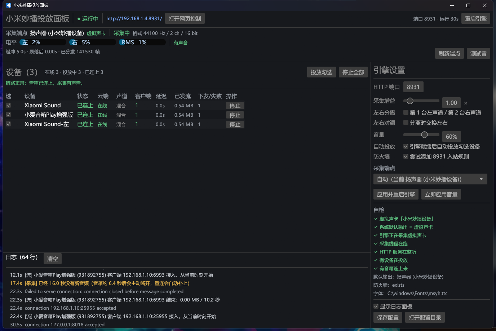
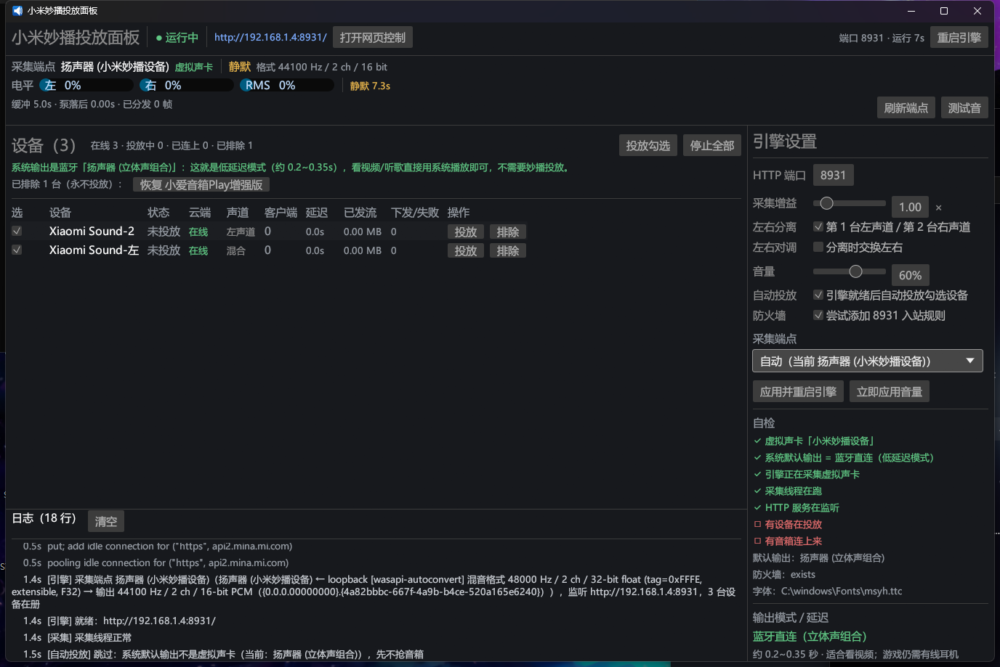

# 桌面投放面板（`miplay-bridge-desktop`）

一个 **双击即可用** 的 Windows exe：窗口里操作小米妙播投放，同时实时观察「采集 → 分发 → 音箱拉流」整条链路。
不用开控制台、不用记命令，也不用先开浏览器。



## 为什么要有它

CLI 的 `hub` 子命令要敲一串参数；网页面板要先开浏览器、而且终端一关引擎就没了。
桌面版把 **GUI + hub 引擎塞进同一个进程**：面板开着 = 8931 在监听 = 播放器随时放歌都有声音。

## 架构

```
┌──────────── UI 线程（eframe / egui，OpenGL）────────────┐
│  顶栏：引擎状态 · 实际 URL · 重启引擎                   │
│  采集栏：端点/格式/左右电平/静默时长 · 测试音            │
│  设备表：勾选/在线/投放/客户端/延迟/已发流/下发失败      │
│  右侧：端口/增益/音量/左右分离/采集端点/自检             │
│  底部：实时日志（tracing Layer 直接进面板）              │
└───────────────┬───────────────────────▲────────────────┘
       Cmd（mpsc 命令）         EngineSnapshot（Mutex 快照，250ms 拉一次）
┌───────────────▼───────────────────────┴────────────────┐
│ 引擎线程（tokio，2 worker）                             │
│  WASAPI 回环采集 → ChannelRouter → 每设备 RingBuffer    │
│  axum :8931（/hub/<did>.wav、/api/hub/*、网页面板）      │
│  MiNA 云 play_by_url 下发 + 断流自动重发                │
└────────────────────────────────────────────────────────┘
```

- 引擎实现在 `crates/miplay-server/src/hub/engine.rs`（`hub::engine`）。它作为 `hub` 的子模块，能直接复用
  原有的 `Args`/`build_roster`/`spawn_pump`/`hub_router` 等私有件，CLI 行为完全不变。
- GUI 只通过 `EngineHandle` 的公开方法（`start_devices` / `stop_devices` / `set_volume` / `test_tone` /
  `snapshot` / `shutdown`）与引擎交互；关窗口会走 `Cmd::Shutdown`，先给云端发 stop 再关流。
- 引擎额外挂了一个 `POST /api/hub/tone?freq=440&seconds=2`：网页、curl、脚本都能一键触发整条链路自测
  （GUI 的「测试音」按钮走同一条命令通道）。

## 构建

```powershell
cargo build --release -p miplay-desktop
# 产物：target\release\miplay-bridge-desktop.exe
```

debug 版带控制台（方便看日志），release 版是无控制台窗口的纯 GUI（`windows_subsystem = "windows"`）。

## 使用（首次）

1. **确认 Windows 输出列表里有「扬声器 (小米妙播设备)」**（虚拟声卡改名，见 `docs/virtual-soundcard.md`），
   并把它设为 **系统默认输出**（面板右侧「自检」里 `系统默认输出 = 虚拟声卡` 应为绿勾）。
2. 双击 `miplay-bridge-desktop.exe`。引擎启动后会自动投放 **勾选的在线设备**（右侧「自动投放」默认开）。
3. 用任何播放器放歌 —— 音箱应同时出声。
4. 想换设备/换声道分配：在左侧设备表勾选 → 点「投放勾选」→ 重启引擎后也可只勾你想用的。

面板里能直接做的操作：**投放/停止、测试音、刷新端点、音量、左右分离/对调、端口/增益/防火墙/采集端点、
重启引擎、打开网页控制**。所有改动里带「需重启」的项会在面板上提示未应用。

## 三种输出模式与延迟（先看这张表）

面板右侧「输出模式 / 延迟」会**自动识别**当前 Windows 默认输出属于哪一种：

| 模式 | 端到端延迟（估计） | 怎么用 | 适合 |
| --- | --- | --- | --- |
| **妙播链路**（虚拟声卡 → 云端 play_url） | **≈1 秒** | 输出选「扬声器 (小米妙播设备)」，面板自动投放 | 音乐、多房间/多台一起放 |
| **蓝牙直连**（Windows 蓝牙 → 「立体声组合」） | **≈0.2–0.35 秒** | 输出直接选蓝牙「立体声组合」；**不要再投放妙播** | 看视频、单房间 |
| **AirPlay 2**（本 crate 原生发送端） | 设计 0.25–0.4 秒 | 当前设备**出不了声**（见下） | — |

实测结论：妙播链路的 PC 侧只有 ~0.25 s，**剩下 ~0.7 s 在音箱固件内部**，云端那条路没法再压。
所以「看视频嫌延迟」的正确解法是**绕开妙播**：蓝牙直连现在已可用；游戏要 <100 ms 只能有线耳机
（L16A 没有 AUX 输入口，无线做不到）。



**面板的保护逻辑**：检测到输出是蓝牙时，它会

- 不自动投放（避免把音箱从蓝牙抢回云端、打断你正在听的声音）；
- 给一条绿色提示「这就是低延迟模式，不需要妙播投放」；
- 仍手动点「投放勾选」也可以，但会弹警告（此时采不到声音）。

**设备排除**：设备行右侧有「排除」小按钮，排除后该设备从列表消失、永不投放；
列表上方会出现「已排除 N 台（永不投放）：恢复 XXX」，点一下就恢复。
默认排除 `小爱音箱Play增强版 (did 931892755)`（可通过配置 `ignored_devices` 改）。

**AirPlay 2 现状（2026-10-18）**：协议层已完整打通（HAP transient pairing + RTSP + UDP 音频，
声明延迟 250 ms，实测发包率 126 pkt/s、欠载 0），但本机这套 L16A 音箱**不出声**。
用两条**互相独立**的发送端都验证过静音：本仓 Rust 实现 + pyatv 0.18.0（Python，参考实现，
早前在同一台设备上人耳确认过出声）。同时云端 TTS/妙播播放**正常有声**，断电重启音箱也无效
→ 判定为**音箱侧 AirPlay 渲染当前异常**，不是发送端问题。暂列不可用，后续可再排查。

## 状态每列的含义

| 列 | 含义 |
| --- | --- |
| 状态 | `未投放` / `已连上`（音箱正在拉流）/ `下发失败` / `等待音箱接入` |
| 客户端 | 当前正在拉这根流的连接数（正常 = 1） |
| 延迟 | 该设备播放位置落后采集多少秒（正常 ≈ 0） |
| 已发流 | 累计推给这台音箱的字节数（放歌时应持续增长） |
| 下发/失败 | 调 `player_play_url` 成功/失败次数 |

## 配置

`%APPDATA%\miplay-bridge\desktop.json`（没有 `APPDATA` 时落在 exe 同目录）。都是可热改的：

| 字段 | 说明 |
| --- | --- |
| `engine.port` / `engine.gain` / `engine.split` / `engine.swap` | 端口 / 采集增益 / 左右分离 / 分离时对调 |
| `engine.firewall` | 是否尝试添加 8931 TCP 入站规则 |
| `engine.capture_device` | 采集端点；`null` = 自动优先「小米妙播设备」 |
| `volume` / `selected` / `show_log` / `tone_seconds` | 音量 / 上次勾选 / 日志面板 / 测试音时长 |
| `auto_start` | 引擎就绪后自动投放勾选设备（默认 `true`，老配置文件缺省也按开算） |
| `ignored_devices` | 永久排除的设备 key 列表（默认 `["931892755"]` = 小爱音箱Play增强版）；排除后不显示、不投放 |

## 排查

| 现象 | 处理 |
| --- | --- |
| 面板显示「已连上」但没声音 | ① 系统默认输出必须是「扬声器 (小米妙播设备)」；② 播放器自身输出别选别的设备；③ 点「测试音」，有声则链路 OK，没声查防火墙（TCP 8931 入站）；④ 右侧「自检」逐项看 |
| 面板显示「未投放」 | 点「投放勾选」；或确认「自动投放」勾着、设备是「在线」 |
| 播放器没声音且面板电平 0% | 播放器没走虚拟声卡输出（换播放器输出设备 / 检查 Windows 默认输出） |
| 看视频延迟 ~1 秒 | 这是妙播链路固有的（大头在音箱固件）。把 Windows 输出切成蓝牙「立体声组合」直连（≈0.2–0.35 s），**并停止妙播投放** |
| 输出是蓝牙、面板还显示「已连上」却没声 | 蓝牙和妙播会抢音箱：点「停止全部」，让音箱留在蓝牙这一路 |
| AirPlay 推过去没声音 | 2026-10-18 实测该音箱侧 AirPlay 渲染异常（Rust/pyatv 两个发送端都静音，云端 TTS 有声）；暂不可用，别把 AirPlay 当看视频方案 |
| 游戏要 <100 ms | 无线做不到（蓝牙/AirPlay 都 ≈0.3 s，L16A 无 AUX）：只有有线耳机/有线音箱可行 |
| `http://192.168.1.4:8931/` 打不开 | 8931 只在**引擎运行期间**监听：面板开着才有。IP 会随网卡变化，以顶栏显示的 URL 为准 |
| 静默一会儿后日志出现「音箱自动断开」 | 正常设计：静默 ~6.4s 音箱会断开，来声音后自动重连（约 1~2s） |

## 已知限制

- 默认**两台设备混流**（同一份音频；小爱音箱Play增强版默认被排除）；要真立体声请开「左右分离」（第 1 台左声道 / 第 2 台右声道）。
- 蓝牙直连是「系统级绕开本项目」的模式：声音不经过虚拟声卡，面板只负责识别+提示，不参与转发；蓝牙只覆盖单房间，也不能多台同步。
- 没有开机自启/托盘；关掉面板 = 停止投放（这是有意的，避免音箱一直被占用）。
- release exe 约 10 MB，依赖系统 OpenGL（Windows 10/11 自带）。

## 测试

```powershell
cargo test -p miplay-server --lib     # 引擎 28 项（含通道映射、电平、状态标签）
cargo build --workspace               # 全仓
```

## 端到端实测（2026-10-18，真机）

环境：`采集端点 = 扬声器 (小米妙播设备)`；三台目标音箱
`Xiaomi Sound (did 934947888)`、`小爱音箱Play增强版 (did 931892755)`、`Xiaomi Sound-左 (did 501718792)`。

**1. 真实播放**（Windows 自带 WAV 从默认输出即虚拟声卡播放）：

| 证据 | 实测值 |
| --- | --- |
| 每台音箱客户端数 | `clients = 1`（音箱正在拉流） |
| 播放位置落后采集 | `lag = 0.0 s` |
| 已发流 | 0.54 MB 起持续增长到 6.36 MB |
| 采集已分发帧 | 1,390,269 → 1,830,141 帧（`44100 Hz / 2 ch / 16 bit`） |
| 日志链路 | `[采集] 长静默后收到音频 → [流] 客户端 192.168.1.171:46342 接入 → [下发] player_play_url` |

**2. 频谱取证**（不是"看着像有声"，而是把推给音箱的字节解出来做 FFT）：

```powershell
# 触发 4s / 440Hz 测试音，同时抓 hub 的流
Invoke-RestMethod -Method Post 'http://127.0.0.1:8931/api/hub/tone?freq=440&seconds=4'
curl.exe -s --max-time 4.5 -o probe.wav http://127.0.0.1:8931/hub/934947888.wav
```

`probe.wav` 自检：`RIFF / fmt=1(PCM) / 2ch / 44100 Hz / 16 bit`，4.50 s、794,624 B。
对 PCM 做 FFT，左右声道主频均为 **440.0 Hz**（top3：440.0 / 440.2 / 439.8 Hz），
`rms = 0.0567`、`peak = 0.091` —— 证明流里送出去的确实是这段正弦音，而不是静音或串流错位。

**3. 地址可达性**（证明监听在 LAN 而非仅回环）：

```text
GET http://192.168.1.4:8931/health -> 200 "ok"
GET http://192.168.1.4:8931/        -> 200 17710 bytes（网页面板）
```

**4. 静默不刷云端**：连续 10 s 无音频时 `plays_sent 1→1`、`reissues 0→0`、`clients 1→1`，
说明不会在静默期反复调 `player_play_url`。

**5. CLI 回归**（lib 化后原有命令不受影响）：

```text
target\debug\miplay-bridge.exe hub --devices 934947888 --dry-run   -> exit 0
监听地址  http://192.168.1.4:8931（0.0.0.0:8931）
采集端点  [render 默认] 扬声器 (小米妙播设备) | 48000 Hz / 2 ch / 32-bit float
分发模式  所有设备同一混音
```

