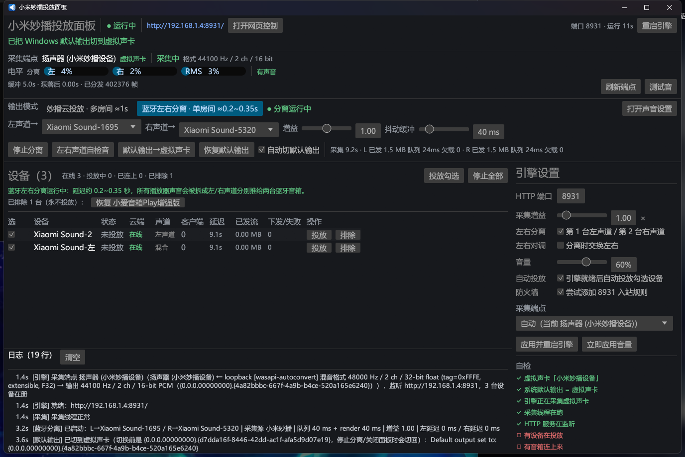

# 桌面投放面板（`miplay-bridge-desktop`）

一个 **双击即可用** 的 Windows exe：窗口里操作小米妙播投放，同时实时观察「采集 → 分发 → 音箱拉流」整条链路。
不用开控制台、不用记命令，也不用先开浏览器。


## 为什么要有它

CLI 的 `hub` 子命令要敲一串参数；网页面板要先开浏览器、而且终端一关引擎就没了。
桌面版把 **GUI + hub 引擎塞进同一个进程**：面板开着 = 8931 在监听 = 播放器随时放歌都有声音。

## 架构

```
┌──────────── UI 线程（eframe / egui，OpenGL）────────────┐
│  顶栏：引擎状态 · 实际 URL · 重启引擎                   │
│  采集栏：端点/格式/左右电平/静默时长 · 测试音            │
│  设备表：勾选/在线/投放/客户端/延迟/已发流/下发失败      │
│  右侧：端口/增益/音量/左右分离/采集端点/自检             │
│  底部：实时日志（tracing Layer 直接进面板）              │
└───────────────┬───────────────────────▲────────────────┘
       Cmd（mpsc 命令）         EngineSnapshot（Mutex 快照，250ms 拉一次）
┌───────────────▼───────────────────────┴────────────────┐
│ 引擎线程（tokio，2 worker）                             │
│  WASAPI 回环采集 → ChannelRouter → 每设备 RingBuffer    │
│  axum :8931（/hub/<did>.wav、/api/hub/*、网页面板）      │
│  MiNA 云 play_by_url 下发 + 断流自动重发                │
└────────────────────────────────────────────────────────┘
```

- 引擎实现在 `crates/miplay-server/src/hub/engine.rs`（`hub::engine`）。它作为 `hub` 的子模块，能直接复用
  原有的 `Args`/`build_roster`/`spawn_pump`/`hub_router` 等私有件，CLI 行为完全不变。
- GUI 只通过 `EngineHandle` 的公开方法（`start_devices` / `stop_devices` / `set_volume` / `test_tone` /
  `snapshot` / `shutdown`）与引擎交互；关窗口会走 `Cmd::Shutdown`，先给云端发 stop 再关流。
- 引擎额外挂了一个 `POST /api/hub/tone?freq=440&seconds=2`：网页、curl、脚本都能一键触发整条链路自测
  （GUI 的「测试音」按钮走同一条命令通道）。
- **蓝牙左右分离**不走引擎：它在 UI 进程里起 3 条线程（`crates/miplay-audio/src/btsplit.rs`，
  `BtSplitHandle`）：1 条 WASAPI 回环采集虚拟声卡 + 2 条 render 线程分别写左/右两个蓝牙端点，
  每条链路自带抖动缓冲（`VecDeque<i16>` 单声道队列）和欠载/丢帧统计，UI 每 250 ms 拉一次 `stats()`。

## 构建

```powershell
cargo build --release -p miplay-desktop
# 产物：target\release\miplay-bridge-desktop.exe
```

debug 版带控制台（方便看日志），release 版是无控制台窗口的纯 GUI（`windows_subsystem = "windows"`）。

## 使用（首次）

1. **确认 Windows 输出列表里有「扬声器 (小米妙播设备)」**（虚拟声卡改名，见 `docs/virtual-soundcard.md`），
   并把它设为 **系统默认输出**（面板右侧「自检」里 `系统默认输出 = 虚拟声卡` 应为绿勾）。
2. 双击 `miplay-bridge-desktop.exe`。引擎启动后会自动投放 **勾选的在线设备**（右侧「自动投放」默认开）。
3. 用任何播放器放歌 —— 音箱应同时出声。
4. 想换设备/换声道分配：在左侧设备表勾选 → 点「投放勾选」→ 重启引擎后也可只勾你想用的。
5. **看视频/直播想低延迟**：顶部「输出模式」切到「蓝牙左右分离」（两台音箱先各自蓝牙连到电脑），
   Windows 默认输出仍保持虚拟声卡，面板会自动起流；用「左右声道自检音」确认左右箱对应正确。
   延迟降到 ≈0.2–0.35 秒，不用妙播云端。

面板里能直接做的操作：**投放/停止、测试音、刷新端点、音量、左右分离/对调、端口/增益/防火墙/采集端点、
重启引擎、打开网页控制**。所有改动里带「需重启」的项会在面板上提示未应用。

## 四种输出模式与延迟（先看这张表）

面板顶部「输出模式」可以在两种模式间切换，延迟差一个数量级：

| 模式 | 端到端延迟（估计） | 怎么用 | 适合 |
| --- | --- | --- | --- |
| **妙播云投放**（虚拟声卡 → 云端 play_url） | **≈1 秒** | 输出选「扬声器 (小米妙播设备)」，面板自动投放 | 音乐、多房间/多台一起放 |
| **蓝牙左右分离**（虚拟声卡回环 → 左右声道分别推给两台蓝牙音箱） | **≈0.2–0.35 秒** | 输出选「扬声器 (小米妙播设备)」；顶部选「蓝牙左右分离」→ 自动起流 | **看视频、直播、网课**（单房间） |
| **蓝牙直连**（Windows 直接连蓝牙「立体声组合」） | **≈0.2–0.35 秒** | 输出直接选蓝牙；不投放妙播 | 临时试听（面板只识别提示，不参与转发） |
| **AirPlay 2**（本 crate 原生发送端） | 设计 0.25–0.4 秒 | 当前设备**出不了声**（见下） | — |

实测结论：妙播链路的 PC 侧只有 ~0.25 s，**剩下 ~0.7 s 在音箱固件内部**，云端那条路没法再压。
所以「看视频嫌延迟」的正确解法是**绕开妙播**：用「蓝牙左右分离」把系统声音拆成左右两路、分别走两条蓝牙链路。

### 蓝牙左右分离（推荐日常看视频用）

- **原理**：① Windows 默认输出 = 虚拟声卡「扬声器 (小米妙播设备)」→ 所有播放器的声音都进这里；
  ② 面板把虚拟声卡回环采下来，拆成左/右单声道；③ 左声道写进 `扬声器 (Xiaomi Sound-1695)`、
  右声道写进 `扬声器 (Xiaomi Sound-5320)`（两条 A2DP 链路，44.1 kHz/16 bit）。
- **两条链路各自独立时钟**：每条链路有自己的抖动缓冲（默认 40 ms），慢了补静音、快了丢最旧样本，
  所以不会越放越错；**两箱之间如果听出「左先右后」的固定时差**，用「左/右链路延迟」做几毫秒到几十毫秒的校正。
- **首次设置**：直接顶部选「蓝牙左右分离」即可——面板会**自动把 Windows 默认输出切到虚拟声卡**，
  不用手动去系统里翻（切换前会记下原输出，停止分离或关面板时自动切回去）。
- **自动/手动切默认输出**：分离控制行有「默认输出→虚拟声卡」「恢复默认输出」两个按钮，
  右边「自动切默认输出」勾选框（配置 `switch_output_on_split`，默认开）。
  注意：**只有正常关窗才会恢复**原默认输出；用任务管理器强杀进程不会恢复，需要手动在
  「声音设置」里切回去（或再开一次面板点「恢复默认输出」）。
- **自检**：点「左右声道自检音」播 12 秒：0–3 s 只有左箱 440 Hz、3–6 s 只有右箱 880 Hz、6–9 s 两边各一路、
  9–12 s 两边同 660 Hz（听感应居中）。
- **参数**：`抖动缓冲`（10–200 ms，破音就加大，想再压延迟就减小）；`增益`；`左/右链路延迟`（校两箱时差）。
- **实测（本机 2026-10-18）**：12 秒测试音，左箱 440 Hz、右箱 880 Hz，**用户人耳确认左右正确**；
  GUI 分离统计 `采集 ≈3.8 s / L 已发 0.6 MB / R 已发 0.6 MB / 队列 12 ms / 欠载 0`；
  延迟主观评价「基本对得上（可接受）」；自动切/恢复默认输出均已真机验证。



> 关于「Windows 能不能同时连两个蓝牙音箱」：微软文档说单适配器只支持一条 A2DP 链路，
> 但本机（Intel AX211，Windows 11 26100）实测**两条 A2DP 同时出声**（左 440 Hz / 右 880 Hz 同时可辨）。
> 这个模式只在本机实测成立，换机器/换驱动不一定可用，以「左右声道自检音」结果为准。

**妙播模式的保护逻辑**：检测到输出是蓝牙时，它不会自动投放（避免把音箱从蓝牙抢回云端）并给提示；
**蓝牙分离模式下点「投放勾选」会被拒绝并提示先切回妙播模式**，因为妙播投放会把音箱从蓝牙抢走。

**设备排除**：设备行右侧有「排除」小按钮，排除后该设备从列表消失、永不投放；
列表上方会出现「已排除 N 台（永不投放）：恢复 XXX」，点一下就恢复。
默认排除 `小爱音箱Play增强版 (did 931892755)`（可通过配置 `ignored_devices` 改）。

**AirPlay 2 现状（2026-10-18）**：协议层已完整打通（HAP transient pairing + RTSP + UDP 音频，
声明延迟 250 ms，实测发包率 126 pkt/s、欠载 0），但本机这套 L16A 音箱**不出声**。
用两条**互相独立**的发送端都验证过静音：本仓 Rust 实现 + pyatv 0.18.0（Python，参考实现，
早前在同一台设备上人耳确认过出声）。同时云端 TTS/妙播播放**正常有声**，断电重启音箱也无效
→ 判定为**音箱侧 AirPlay 渲染当前异常**，不是发送端问题。暂列不可用，后续可再排查。

## 状态每列的含义

| 列 | 含义 |
| --- | --- |
| 状态 | `未投放` / `已连上`（音箱正在拉流）/ `下发失败` / `等待音箱接入` |
| 客户端 | 当前正在拉这根流的连接数（正常 = 1） |
| 延迟 | 该设备播放位置落后采集多少秒（正常 ≈ 0） |
| 已发流 | 累计推给这台音箱的字节数（放歌时应持续增长） |
| 下发/失败 | 调 `player_play_url` 成功/失败次数 |

## 配置

`%APPDATA%\miplay-bridge\desktop.json`（没有 `APPDATA` 时落在 exe 同目录）。都是可热改的：

| 字段 | 说明 |
| --- | --- |
| `engine.port` / `engine.gain` / `engine.split` / `engine.swap` | 端口 / 采集增益 / 左右分离 / 分离时对调 |
| `engine.firewall` | 是否尝试添加 8931 TCP 入站规则 |
| `engine.capture_device` | 采集端点；`null` = 自动优先「小米妙播设备」 |
| `output_mode` | `"cloud"`（妙播云投放）/ `"bluetooth"`（蓝牙左右分离）；面板顶部可切 |
| `split.enabled` | 打开面板时自动开始蓝牙左右分离（默认 `true`） |
| `split.left_endpoint` / `split.right_endpoint` | 左/右声道推给哪个 render 端点（名字子串，默认 `Xiaomi Sound-1695` / `Xiaomi Sound-5320`） |
| `split.gain` / `split.queue_ms` | 分离增益（1.0）/ 抖动缓冲毫秒（默认 40） |
| `split.left_delay_ms` / `split.right_delay_ms` | 左/右链路额外延迟（校两箱固定时差） |
| `switch_output_on_split` | 开始蓝牙分离/打开面板时自动把 Windows 默认输出切到虚拟声卡（默认 `true`）；停止分离或正常关窗时切回原输出 |
| `previous_output` | 自动切换前的默认输出端点 id（切换时写入，恢复后清空；不要手动改） |
| `volume` / `selected` / `show_log` / `tone_seconds` | 音量 / 上次勾选 / 日志面板 / 测试音时长 |
| `auto_start` | 引擎就绪后自动投放勾选设备（默认 `true`，老配置文件缺省也按开算） |
| `ignored_devices` | 永久排除的设备 key 列表（默认 `["931892755"]` = 小爱音箱Play增强版）；排除后不显示、不投放 |

## 排查

| 现象 | 处理 |
| --- | --- |
| 面板显示「已连上」但没声音 | ① 系统默认输出必须是「扬声器 (小米妙播设备)」；② 播放器自身输出别选别的设备；③ 点「测试音」，有声则链路 OK，没声查防火墙（TCP 8931 入站）；④ 右侧「自检」逐项看 |
| 面板显示「未投放」 | 点「投放勾选」；或确认「自动投放」勾着、设备是「在线」 |
| 播放器没声音且面板电平 0% | 播放器没走虚拟声卡输出（换播放器输出设备 / 检查 Windows 默认输出） |
| 看视频延迟 ~1 秒 | 这是妙播链路固有的（大头在音箱固件）。顶部切到「蓝牙左右分离」（≈0.2–0.35 s），输出仍用虚拟声卡；**不要再投放妙播** |
| 蓝牙分离没声音 | ① 顶部是否显示「分离运行中」；② Windows 默认输出必须是虚拟声卡（否则播放器声音不经过分离链路）；③ 点「左右声道自检音」确认左右箱都有声；④ 两台音箱要在 Windows 蓝牙设置里显示「已连接」 |
| 蓝牙分离有破音/卡顿 | 调大「抖动缓冲」（40 → 80/120 ms）；检查两个蓝牙端点是否都被其他程序占用；看日志 `[蓝牙分离]` 的欠载计数 |
| 蓝牙分离左右箱有固定时差（声像偏） | 用 `split.left_delay_ms` / `split.right_delay_ms` 给先到的一侧加几毫秒到几十毫秒 |
| 蓝牙分离左右反了 | 把「左声道→」「右声道→」两个下拉框对调 |
| 蓝牙分离模式下点「投放勾选」被拒绝 | 设计如此：妙播投放会把音箱从蓝牙抢回云端；要投放先切回「妙播云投放」 |
| 输出是蓝牙、面板还显示「已连上」却没声 | 蓝牙和妙播会抢音箱：点「停止全部」，让音箱留在蓝牙这一路 |
| AirPlay 推过去没声音 | 2026-10-18 实测该音箱侧 AirPlay 渲染异常（Rust/pyatv 两个发送端都静音，云端 TTS 有声）；暂不可用，别把 AirPlay 当看视频方案 |
| 游戏要 <100 ms | 无线做不到（蓝牙/AirPlay 都 ≈0.3 s，L16A 无 AUX）：只有有线耳机/有线音箱可行 |
| `http://192.168.1.4:8931/` 打不开 | 8931 只在**引擎运行期间**监听：面板开着才有。IP 会随网卡变化，以顶栏显示的 URL 为准 |
| 静默一会儿后日志出现「音箱自动断开」 | 正常设计：静默 ~6.4s 音箱会断开，来声音后自动重连（约 1~2s） |

## 性能开销（实测）

测试环境：Intel i5-14600K（20 线程）、31.6 GB 内存、Windows 11 26100、release 版 exe（10.5 MB）。
用性能计数器 `\Process(*)\% Processor Time` 采 25 秒，取中位/平均；「单核%」= 占一个逻辑核的比例
（任务管理器里多核总量要再除以 20，约 **0.2%**）。

| 运行状态 | CPU（单核） | CPU（全机 20 线程） | 工作集 | 私有内存 | 线程 | 句柄 |
| --- | --- | --- | --- | --- | --- | --- |
| 仅 CLI 引擎（`hub` 子命令，无 GUI / 无分离） | 0.26% | 0.013% | 22.7 MB | 6.6 MB | 31 | 305 |
| 面板 + 蓝牙分离（可见，无音频） | 3.5–4.6% | 0.17–0.23% | 147 MB | 167 MB | 32–37 | ~650 |
| 面板 + 蓝牙分离（最小化） | 5.5–6.2% | 0.28–0.31% | 134 MB | 130 MB | 19 | 526 |
| 面板 + 蓝牙分离（连续播放音频） | 4.7% | 0.23% | 147 MB | 171 MB | 34 | ~650 |

结论：

- **总负荷很小**：常驻约 **4–5% 的单个核心**（整机 0.2% 左右），内存 **≈150 MB**（占 31.6 GB 的 0.5%）。
  采样本机还有浏览器/IDE 等负载，绝对值会上下浮动 ±1.5% 单核。
- **播放音频几乎不增加 CPU**（4.6% → 4.7%）：分离链路恒定按 44.1 kHz 处理，跟有没有声音无关。
- 开销大头是 **音频三线程（1 采集 + 2 路蓝牙 sink，各以 10 ms 为周期写/轮询）** 和 **UI 重绘（每 250 ms 一帧）**；
  最小化后 UI 线程释放图形资源，内存降到 134 MB。
- **虚拟声卡本身几乎零开销**：它是内核态驱动服务 `SteamStreamingSpeakers.sys`（40 KB，
  `Get-Service SteamStreamingSpeakers` 可见 Running），**没有用户态进程**。只有程序打开它的回环采集流时才产生
  CPU/内存成本（就是上表里本项目的采集线程）；没人采集时基本不占资源。
- 磁盘 IO ≈ 0（只在切默认输出/写配置时读几个 KB）；网络只在妙播云投放模式下发流时有流量；
  GPU 走 OpenGL 绘制静态界面，任务管理器里 <1%。
- 可优化项（当前没做，收益约 1–2% 单核）：蓝牙分离模式下云投放引擎的采集/分发仍在空转，
  切到该模式时可以把引擎采集线程停掉；UI 重绘也可以从 250 ms 放宽到 500 ms。

## 已知限制

- 默认**两台设备混流**（同一份音频；小爱音箱Play增强版默认被排除）；要真立体声请开「左右分离」（第 1 台左声道 / 第 2 台右声道）。
- **蓝牙左右分离只覆盖单房间两台箱**：左右两路各走一条独立 A2DP 链路，Windows 侧没有跨端点时钟同步原语，
  靠每条链路自己的抖动缓冲吸收时钟漂移（长时间播放理论上会有偶尔丢样本，可监听日志欠载/丢帧计数）。
- 游戏要 **<100 ms** 无线做不到（蓝牙/AirPlay 都 ≈0.2–0.35 s，L16A 无 AUX）：只有有线耳机/有线音箱可行。
- 蓝牙直连是「系统级绕开本项目」的模式：声音不经过虚拟声卡，面板只负责识别+提示，不参与转发。
- 没有开机自启/托盘；关掉面板 = 停止投放（这是有意的，避免音箱一直被占用）。
- 自动切默认输出**只在正常关窗时恢复**：强杀进程/蓝屏会留在虚拟声卡上，需要手动切回（面板再开一次也可恢复）。
- release exe 约 10 MB，依赖系统 OpenGL（Windows 10/11 自带）。

## 测试

```powershell
cargo test -p miplay-server --lib     # 引擎 28 项（含通道映射、电平、状态标签）
cargo test -p miplay-audio --lib      # 音频 58 项（含蓝牙左右分离的配置校验/队列丢帧/增益钳制/低延迟模式）
cargo test -p miplay-desktop --bins   # 桌面面板 2 项（虚拟声卡识别 / 内嵌切换脚本必须是 ASCII）
cargo build --workspace               # 全仓
```

## 端到端实测（2026-10-18，真机）

环境：`采集端点 = 扬声器 (小米妙播设备)`；三台目标音箱
`Xiaomi Sound (did 934947888)`、`小爱音箱Play增强版 (did 931892755)`、`Xiaomi Sound-左 (did 501718792)`。

**1. 真实播放**（Windows 自带 WAV 从默认输出即虚拟声卡播放）：

| 证据 | 实测值 |
| --- | --- |
| 每台音箱客户端数 | `clients = 1`（音箱正在拉流） |
| 播放位置落后采集 | `lag = 0.0 s` |
| 已发流 | 0.54 MB 起持续增长到 6.36 MB |
| 采集已分发帧 | 1,390,269 → 1,830,141 帧（`44100 Hz / 2 ch / 16 bit`） |
| 日志链路 | `[采集] 长静默后收到音频 → [流] 客户端 192.168.1.171:46342 接入 → [下发] player_play_url` |

**2. 频谱取证**（不是"看着像有声"，而是把推给音箱的字节解出来做 FFT）：

```powershell
# 触发 4s / 440Hz 测试音，同时抓 hub 的流
Invoke-RestMethod -Method Post 'http://127.0.0.1:8931/api/hub/tone?freq=440&seconds=4'
curl.exe -s --max-time 4.5 -o probe.wav http://127.0.0.1:8931/hub/934947888.wav
```

`probe.wav` 自检：`RIFF / fmt=1(PCM) / 2ch / 44100 Hz / 16 bit`，4.50 s、794,624 B。
对 PCM 做 FFT，左右声道主频均为 **440.0 Hz**（top3：440.0 / 440.2 / 439.8 Hz），
`rms = 0.0567`、`peak = 0.091` —— 证明流里送出去的确实是这段正弦音，而不是静音或串流错位。

**3. 地址可达性**（证明监听在 LAN 而非仅回环）：

```text
GET http://192.168.1.4:8931/health -> 200 "ok"
GET http://192.168.1.4:8931/        -> 200 17710 bytes（网页面板）
```

**4. 静默不刷云端**：连续 10 s 无音频时 `plays_sent 1→1`、`reissues 0→0`、`clients 1→1`，
说明不会在静默期反复调 `player_play_url`。

**5. CLI 回归**（lib 化后原有命令不受影响）：

```text
target\debug\miplay-bridge.exe hub --devices 934947888 --dry-run   -> exit 0
监听地址  http://192.168.1.4:8931（0.0.0.0:8931）
采集端点  [render 默认] 扬声器 (小米妙播设备) | 48000 Hz / 2 ch / 32-bit float
分发模式  所有设备同一混音
```

