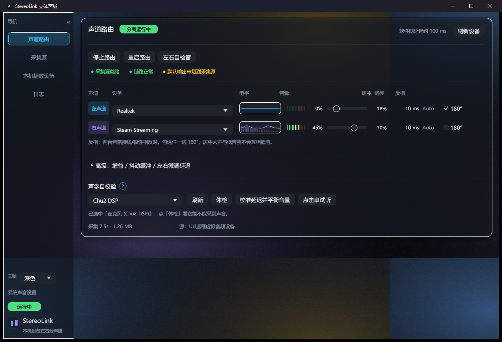
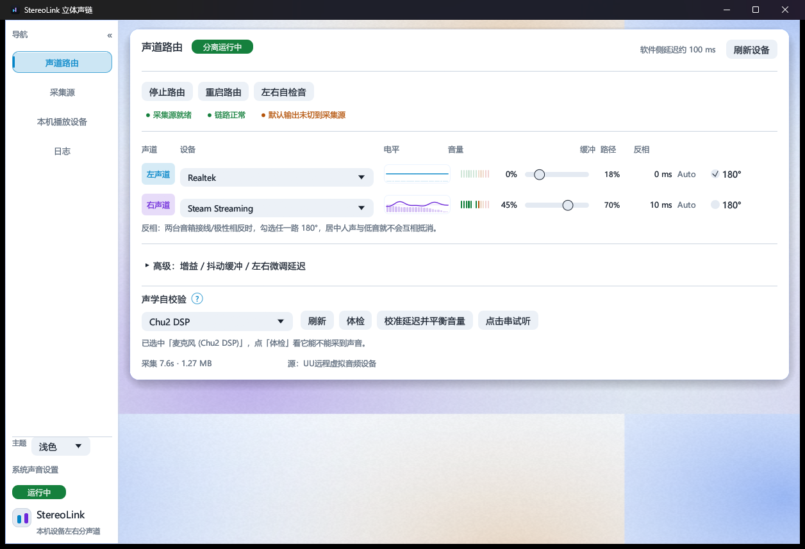

# StereoLink 面板手册

`stereo-link.exe` 是 StereoLink（立体声链）的桌面面板，一个双击就能用的 Windows 程序：把系统
声音拆成左 / 右声道，分别推给两台本机播放设备，同时在界面上实时显示整条链路的状态。



- 程序形态：单个 exe（EGUI/OpenGL 绘制），也可用安装包安装；没有后台服务、没有网页前端。
- 运行前提：本机有一个**不会被听见的输出端点**可以当采集源（虚拟音频设备，或没接音箱 / 显示器的
  物理输出）。**零安装就能用**：不用装驱动、不用重启、不用第三方软件。
- 没有现成的无声端点时：运行一次 UU远程（免费，会装好一个虚拟音频设备），或安装可选的
  自研虚拟声卡（高级路径，需测试签名 + 重启一次）。详见
  [`virtual-soundcard.md`](virtual-soundcard.md)。

## 启动前准备

1. **准备一个采集源**（三种任选其一）：
   - 本机已有的**虚拟音频设备**：自研 StereoLink 虚拟声卡（「扬声器 (立体声链虚拟声卡)」）、
     UU远程虚拟音频设备（「扬声器 (UU远程虚拟音频设备)」）、Steam Streaming 等，最省事、无声；
   - 一个**没接音箱 / 显示器的物理输出**：板载 Realtek 扬声器口、空着的 HDMI / DP——不会出声，
     但系统认为它是正常输出，可以回环采集；
   - 都没有 → **先运行一次 UU远程**（免费），它会装好一个虚拟音频设备；回到面板点「刷新设备」，
     在「采集源」页里选「扬声器 (UU远程虚拟音频设备)」。
2. **把两台蓝牙音箱连到本机**：设置 → 蓝牙和设备 → 添加设备；连好后它们会出现在
   「声音 → 输出」列表里。
3. 双击 `stereo-link.exe`。启动后如果采集源已经自动选好，直接点「开始路由」即可。

> 自研虚拟声卡是**可选的高级路径**：驱动是自签的，安装需要开启测试签名并重启一次，Secure Boot
> 必须关闭，桌面会常驻「测试模式」水印。普通用户优先用已有的虚拟设备或 UU远程。

## 界面总览

界面按「左侧可收起侧边栏 + 四个页面」组织，**没有顶部工具栏**：

```text
┌──────────────────────────────────────────────────────────────────────────────┐
│ 声道路由                                    分离运行中      软件侧延迟约 100 ms│
│ [开始路由] [左右自检音]                                       [刷新设备]      │
│ ● 采集源就绪      ● 链路正常      ● 默认输出 = 采集源                        │
│ ──────────────────────────────────────────────────────────────────────────── │
│ 声道 设备            波形+频谱  电平  音量      缓冲 路径  反相                │
│ 左声道 [▼ 设备 A]   ∿∿∿∿∿∿  ▮▮▮▯▯  ▁▁●▁▁ 32%  0 ms  Auto  □ 180°            │
│ 右声道 [▼ 设备 B]   ∿∿∿∿∿∿  ▮▮▮▯▯  ▁▁●▁▁ 32%  0 ms  Auto  □ 180°            │
│ 反相：两台音箱接线/极性相反时，勾选任一路 180°，居中的人声与低音…              │
│ ▸ 高级：增益 / 抖动缓冲 / 左右微调延迟                                        │
│ 声学自校验 [麦克风 ▼] [刷新] [体检] [校准延迟并平衡音量]                      │
├────────────┬─────────────────────────────────────────────────────────────────┤
│ 导航     « │                                                                 │
│  声道路由  │                                                                 │
│  采集源    │                                                                 │
│  本机播放设备│                                                               │
│  日志      │                                                                 │
│            │                                                                 │
│  [运行中]  │                                                                 │
│ StereoLink │                                                                 │
│  立体声链  │                                                                 │
│ 主题 深色▼ │                                                                 │
│ 系统声音设置│                                                               │
└────────────┴─────────────────────────────────────────────────────────────────┘
```

- 窗口默认 1240×820，最小 1040×660；侧边栏展开约 200 px，收起后只留单字图标。
- 界面每 250 ms 刷新一次（电平、诊断、统计跟随刷新）；真正的端点枚举在后台线程里做，
  所以拖窗口、切页不会卡（见 [FAQ](#常见问题)）。
- 四个页面：**声道路由**（默认页）、**采集源**、**本机播放设备**、**日志**。

## 外观与主题

面板用「玻璃拟态」视觉：**柔光底纹 + 半透明卡片 + 描边高光**。底层是一张预渲染的柔光纹理
（竖直渐变 + 三团缓慢漂移的色斑 + 极淡噪点，画在窗口最底层、每帧只改 UV 不重新栅格化），
四张卡片是叠在上面的半透明玻璃面（1 px 描边 + 投影），所以整块界面有层次和深度。

- **主题**：侧边栏底部可选 **白天 / 黑夜 / 跟随系统**，选择会写进配置（`theme`），下次启动照旧。
  「跟随系统」跟着 Windows 的应用深浅色设置实时切换。
- **行内波形 + 频谱**：路由表每一路都有一条 104×30 的迷你画布——底纹是 22 根对数频谱柱，
  前景是该声道的波形线（左声道蓝、右声道琥珀），**由这一路真实的电平驱动**，快攻慢放、带峰值保持。
- **分段电平条**：电平列是 12 段刻度（绿 → 黄 → 红）+ 峰值保持白线，比进度条更容易看出余量。
- **动效**：侧边栏选中胶囊平滑移动、按钮悬停抬升 / 按下回弹、卡片悬停描边提亮；
  页面切到非路由页或窗口收进托盘时停止重绘，不空转 CPU。
- 所有装饰都是**只读的显示**：关掉路由后波形会回落到静止，不会影响音频本身。

浅色主题下的同一页：



## 侧边栏与四个页面

左侧「导航」栏是页面入口，底部「收起侧边栏」可把它收成只留单字图标的窄条（「路」「源」「设」「志」），
收起后照样可以点图标切页。侧边栏底部自上而下是：运行状态徽章（**运行中** / **已停止**）、
产品图标与名称/简介、**主题**选择（白天 / 黑夜 / 跟随系统）、**系统声音设置**入口。

| 页面 | 内容 | 常用操作 |
| --- | --- | --- |
| 声道路由 | 左 / 右声道的设备、实时电平、每路音量条、缓冲、写入路径、反相；「高级」折叠里有增益 / 抖动缓冲 / 左右微调延迟；声学自校验区 | 选左右设备、拖音量、勾反相、校准延迟并平衡音量 |
| 采集源 | 采集源类别与端点名、系统默认输出是否一致、采集源下拉、开始路由时自动切换、（端点格式 / 系统音量策略 / 播放测试音） | 选采集源、切 / 恢复默认输出、改系统音量联动策略 |
| 本机播放设备 | 本机全部播放端点：格式下拉框、角色徽章、设为左 / 设为右 / 修正 | 改设备格式、把设备分配给左右声道、点「刷新设备」重新枚举 |
| 日志 | 面板进程内日志（运行统计每 30 秒一条，含已发流 / 欠载 / 重连）、复制诊断 / 复制全部 / 清空、自动滚动、字体信息 | 排障、留证 |

## 声道路由页顶部

顶栏已取消，操作按钮和诊断徽章都归到**声道路由页顶部**：

| 元素 | 说明 |
| --- | --- |
| 开始路由 / 停止路由 | 同一个位置上按状态切换；开始成功会弹 toast，未选设备会提示 |
| 重启路由 | 设备插拔、改完高级参数后手动重启采集 + 播放 |
| 左右自检音 | 往左、右两个目标设备各播放一段测试音，确认接线和声道没有接反（时长取配置 `tone_seconds`，默认 3 秒） |
| 刷新设备 | 重新枚举本机播放端点与设备默认格式（插拔设备、装完 UU远程 / 虚拟声卡后点一下）；**本机播放设备页也有一个** |
| 三项诊断徽章 | 采集源就绪 / 链路正常 / 系统默认输出，见下 |
| 右上提示 | 操作反馈或「已按测量结果自动对齐左右延迟」这类一次性提示，几秒后消失 |

侧边栏底部另有两个入口：**主题**（白天 / 黑夜 / 跟随系统，选择会记进配置 `theme`；「跟随系统」
指跟随 Windows「设置 → 个性化 → 颜色 → 选择模式」的应用模式，切换即时生效）与
**系统声音设置**（打开 Windows 的「设置 → 系统 → 声音」）。

## 诊断徽章

声道路由页顶部常驻 **3 个徽章**（原来是顶栏下方的诊断条，顶栏取消后并入本页），不占正文：

- `采集源就绪`：采集源端点是否存在、能否打开；
- `链路正常`：路由是否在跑、两路有没有报错 / 欠载 / 重连；
- `默认输出 = 采集源`：Windows 默认播放设备是否就是采集源（不一致就采不到声音）。

绿色 = 正常，琥珀色 = 需要注意，红色 = 明确有问题；鼠标悬停看具体原因。更细的诊断清单和
运行统计在「日志」页，点「复制诊断」可以一次性复制给他人排查。

## 声道路由

实时控制区，也是面板的核心：

- **声道表**：左声道 / 右声道各一行，列为「声道、设备、电平、音量、缓冲、路径、反相」。
  设备下拉框列出本机 render 端点（已排除当前采集源）。未运行时电平为 0%、缓冲显示 `—`。
  「已发流 / 欠载」这类累计数字不再常驻表格，改由「日志」页每 30 秒输出一条运行统计。
- **电平**：该路实时电平条。
- **音量**：每路的音量条（0–100%），拖动即可改**该路目标音箱的端点音量**，详见
  「[每路音量条与左右平衡](#每路音量条与左右平衡)」。
- **缓冲**：该路当前的抖动缓冲（ms）；数值在「高级：增益 / 抖动缓冲 / 左右微调延迟」里调。
- **路径**：`Auto` = WASAPI 自动转换（只转采样格式、**零重采样**），悬停可看完整路径，
  例如 `wasapi-autoconvert（48000 Hz / 2 ch / 16-bit int，零 SRC）`；显示「转换」= 目标端点
  混音采样率与引擎不一致，这一路会走软件重采样（可能引入损失）；设备掉线时显示「重连」。
- **反相**：每路一个 `180°` 复选框，见「[反相怎么用](#反相怎么用)」。
- **高级：增益 / 抖动缓冲 / 左右微调延迟**（折叠）：
  - 增益 0.0–2.0，步进 0.05，默认 1.0；数字增益超过设备余量会削顶。
  - 抖动缓冲 10–200 ms，步进 5，默认 40；蓝牙不稳定、出现欠载时调大。
  - 左右微调延迟：左 / 右各 0–500 ms，给声音较早的那只音箱加延迟来补偿固定时差。
- **声学自校验**：用本机麦克风量出两台音箱的真实到达时间差，自动给较慢的一路垫延迟；
  同一次测量还会给出左右音量平衡建议。
  - 先在下拉里选一个麦克风（内置 / USB / 虚拟 / 回环端点都列出来并标了类别），点「体检」确认
    它真能采到声音；
  - 点「校准延迟并平衡音量」（约 8 秒）：先试**同时法**（精度约 ±1 ms），失败退回**依次法**
    （约 ±4 ms），测完自动写入左右微调延迟；接着量左右电平差，给出「左边轻了 x dB」和
    「建议音量 左 a% / 右 b%」；
  - 点「应用并复测」按建议值写回两台音箱的端点音量并自动复测（蓝牙音箱通常 2～3 轮收敛）；
  - 没有麦克风也能用「点击串试听」：按当前延迟值同时放点击串，听到两下就手动微调。
  - 本机（Windows 11）实测：`麦克风 (Chu2 DSP)` 这类 USB 声卡**必须走独占模式**才采得到真实
    数据，共享模式的录音是一条 -96.7 dBFS 的平底（等于没声音）。面板的测量路径自动「独占优先、
    共享兜底」，不用手动设置；体检结果里会标出实际使用的采集方式。两只音箱要**同时在线**，
    且测量时都在出声。

修改路由设备或分路设置时会自动保存配置；改动后如果路由在跑，面板会重启路由让新配置生效。

## 采集源

决定引擎从哪个播放端点的 WASAPI 回环流里取声。**这个端点必须同时是 Windows 默认输出**
（面板开始路由时会自动切过去），否则播放器的声音不会流进它。

| 元素 | 说明 |
| --- | --- |
| 类别徽标（右上） | 当前采集源的类别：`虚拟设备` / `物理输出（可能出声）` / `蓝牙音箱（会重复出声，别选）`；找不到端点时显示「未找到」 |
| 当前采集端点 | 大字号显示名称；没找到时显示「未找到可用端点」 |
| 系统默认输出 | 当前 Windows 默认播放设备；与采集源一致时带绿色对勾 √，不一致时标黄提醒 |
| 常驻说明 | 「采集源必须同时是 Windows 默认输出，否则采不到声音。」 |
| 采集源下拉 | 列出本机所有 render 端点，每项带类别标注；同名端点按端点 id 精确匹配，不会选错 |
| 「开始路由时自动切为默认输出（退出时切回）」 | 默认勾选。勾选时开始路由会自动把默认输出切成采集源，停止 / 正常退出时切回原来的设备 |
| 切为默认输出 | 手动把默认输出切到采集源（开始路由前也可以先手动切） |
| 恢复原输出 | 切回开始路由前记录的那台设备；没有记录时按钮禁用 |
| 端点格式 | 只读显示该端点当前混音格式（例如 `混音 48000 Hz / 2 ch / 32-bit float`） |
| 系统音量 | 三选一 `自动` / `跟随系统音量` / `不联动`，默认 `自动`。状态文字显示「跟随中：xx%」或「不联动」 |
| 播放测试音 | 往采集源与左右两路放一小段测试音，确认整条链路是否通 |

**系统音量联动的分类**（`自动` 策略）：

- **第三方虚拟音频设备**（UU远程、Steam Streaming 等）：不吃系统音量——调它的音量对采集流
  无效，所以把采集源的音量 / 静音镜像到每台目标设备，拖 Windows 音量条时音箱跟着变；
- **自研虚拟声卡、板载 / HDMI 等物理输出**：WASAPI 回环取的是端点混音器输出（后置音量），
  采集幅度本来就会跟着音量变，再镜像一次会双重生效，所以自动模式不联动。

`跟随系统音量` = 始终镜像；`不联动` = 完全不碰目标设备音量。镜像每 400 ms 检查一次、变化超过
0.5% 才写入；停止路由 / 正常退出时把目标设备音量还原成开始前的值（**强杀不还原**）。

**关于改名**：面板**不提供虚拟声卡改名**。改名只影响显示名，对采集和路由没有帮助，需要时只能改
驱动 INF 重新签名安装。仓库里保留的 `scripts\gui-set-name.ps1`、`scripts\rename-endpoint.ps1`
只是底层开发工具，面板不调用。

## 每路音量条与左右平衡

- **拖动即改端点音量**：声道路由表里每一路的音量条直接对应那台音箱在 Windows 里的「音量」。
  拖动时面板按 250 ms 节流写回系统音量，并定期（每 1 秒）从设备读回，保证显示的就是设备当前
  音量；不用切到 Windows 音量合成器。
- 与「系统音量」联动的关系：`自动` / `跟随系统音量` 模式下，采集源音量变化会在 400 ms 内镜像
  覆盖这两条音量条；`不联动` 时手动拖动的值保持不变。
- 停止路由 / 正常退出时，面板会把目标设备音量还原成开始路由前的值（强杀不还原）。
- **左右平衡**：点声学自校验区的「校准延迟并平衡音量」，同一次麦克风测量会给出两路电平差
  （例如「左 -23.9 dB / 右 -38.7 dB → 左边轻了 14.8 dB」），并给出「建议音量 左 45% / 右 100%」
  （带置信度；±1.5 dB 以内的差值视为平衡，不折腾）。点「应用并复测」按建议百分比写回左右端点
  音量，然后自动再测一轮。建议值只是起点，最终以实际听感为准。

## 反相怎么用

两只音箱**接线或单元极性相反**时，居中的人声和低音会在房间里互相抵消（听感：人声小、发虚、
低音没劲）。这时在声道路由表里给**相反的那一路**勾上 `180°` 反相即可把极性修回来：

- 复选框就在声道表格里，每一路一个，勾完立即生效（路由在跑会自动重启并应用）；
- **只勾一路**：两路都勾等于没勾；
- 判断哪一路反相：先放一段居中的人声，勾左或勾右试一次，哪个听着人声与低音更实就用哪个；
  拿不准就保持不勾（默认不反相）。

## 托盘与关闭行为

- **点窗口关闭按钮**会弹出「关闭 StereoLink」确认框，三选一：
  - **缩小至托盘**：窗口藏起来，路由与左右声道输出继续在后台运行，双击（单击）托盘图标可唤回；
  - **直接关闭**：停止路由、恢复系统默认输出并退出；
  - 勾「下次不再提示（记住我的选择）」后再选上面任意一项，以后关闭就不再询问（选择记在
    `config.json` 的 `close_behavior`：`minimize` / `quit`，没记住时为 `ask`）。
- **托盘图标**：左键单击唤回主窗口；右键菜单有「显示主界面」和「退出」。「退出」= 停止路由、
  恢复默认输出、退出进程（和「直接关闭」等价）。
- 托盘不可用时（通知区域被系统策略禁用、创建图标失败），点关闭会退化为**普通最小化**，并在日志
  里说明，不会出现「窗口凭空消失」。
- 注意：隐藏到托盘期间路由继续在跑，CPU 占用仍会存在；要彻底退出请用托盘菜单的「退出」或
  关闭框里的「直接关闭」。

## 日志

「日志」页显示面板进程内的 tracing 日志（默认最多 1000 行），行首是相对启动的秒数：

- **自动滚动**：新日志自动滚到最新一行，可关闭；
- **运行统计**：每 30 秒写一条 `[统计] … 已发 x MB | 欠载 n | 缓冲 x ms`；某路欠载数或错误 /
  重连状态变化时会立即补一条。声道路由表格里不再常驻这些数字；
- **复制诊断 / 复制全部 / 清空**：复制排障摘要、复制全部日志、清空界面缓冲（只清界面，不落盘）；
- 页面底部显示当前使用的中文字体路径；找不到中文字体时中文可能显示为方块，面板会给出警告。

## 推荐操作流程

1. 打开面板，在「采集源」页选一个无声的本机输出端点（虚拟音频设备优先；没有就先跑一次
   UU远程再刷新）。确认「系统默认输出」一项与采集源一致（或勾选自动切换）。
2. 连好两台蓝牙音箱，在「本机播放设备」页点一次「刷新设备」。
3. 回到「声道路由」页，给左声道选设备 A、右声道选设备 B（也可以在设备页点「设为左 / 设为右」）。
4. 点「左右自检音」：确认左右两只箱子各自出声且**方向正确**（左箱只出左声道）。房间固定的话
   跑一次「校准延迟并平衡音量」，自动对齐两只箱的到达时间并给出音量平衡建议。
5. 点「开始路由」。用任意播放器放歌 / 看视频，声音就被拆成左右两路；拖每路音量条或拖 Windows
   音量条都能控制音箱（采集源不吃系统音量时面板会自动镜像，见「系统音量」）。
6. 关闭窗口时选择「缩小至托盘」（后台继续）或「直接关闭」（停止路由、恢复默认输出并退出）。

## 参数怎么调

| 场景 | 调整 |
| --- | --- |
| 声音断续、日志里「欠载」在涨 | 把「高级 → 抖动缓冲」调大（40 → 60 / 100 ms）；蓝牙距离拉近，断开其它蓝牙设备 |
| 人声低 / 发闷 / 音质差 | 先看采集源页的系统音量与端点音量是否过低（音量条拉满）；再看「路径」列应为 `Auto`（零 SRC），显示「转换」说明目标端点混音采样率不一致 |
| 调 Windows 音量，音箱音量不跟着变 | 「采集源 → 系统音量」选「跟随系统音量」；默认「自动」只对 UU远程 / Steam 这类不吃系统音量的采集源镜像 |
| 两只箱同时响，居中的人声发虚、低音互相抵消 | 两只箱极性相反：在声道路由表里勾对应那一路的 `180°`（只勾一路） |
| 轻微滋啦 / 杂音 | 确认「路径」列是 `Auto`（48000 Hz 零 SRC）、端点音量 100%、增益回到 1.0；仍存在就查蓝牙链路 / 音箱侧 |
| 延迟嫌大 | 把「高级 → 抖动缓冲」调小（最小 10 ms），但要接受更频繁的欠载风险 |
| 两只音箱不同步 / 音量不一致 | 用「校准延迟并平衡音量」让麦克风自动测量并对齐；没有麦克风就展开「高级」手动调延迟，或边听「点击串试听」边调 |
| 音箱关机 / 蓝牙断连，过一会儿又回来 | 不用管：面板会自己重连（该路「路径」列显示「重连」并提示第几次失败、几秒后重试），设备回来后自动恢复发声；不需要点「重启路由」 |
| 接反了左右 | 对调左 / 右声道的设备选择，再点一次「重启路由」 |
| 采集源自己出声 | 换成虚拟音频设备或没接音箱的物理输出 |

## 配置与数据路径

| 路径 | 内容 |
| --- | --- |
| `%APPDATA%\stereo-link\config.json` | 面板配置（没有 `APPDATA` 时在 exe 同目录）；界面上的改动会自动保存 |
| `%TEMP%\stereo-link\switch-audio-default.ps1` | 切换默认输出的临时脚本，由面板从内嵌资源释放 |
| `scripts\backups\` | 仓库里改名工具 `scripts\rename-endpoint.ps1` 的备份目录（开发工具，面板不调用） |

配置字段含义见仓库根目录 [`README.md`](../README.md) 的「配置与数据路径」一节。

## 常见问题

| 问题 | 处理 |
| --- | --- |
| 关窗后程序去哪了 | 默认行为是「缩小至托盘」：窗口隐藏、路由继续在后台跑，托盘图标里能找到。要彻底退出：托盘图标右键 →「退出」，或关闭框里选「直接关闭」 |
| 怎么彻底退出 | 托盘菜单「退出」或关闭框「直接关闭」：都会停止路由、恢复系统默认输出再退出进程。任务管理器结束进程属于异常退出，不会恢复默认输出 / 音量 |
| 音量条改的是什么 | 改的是**那台目标音箱在 Windows 里的端点音量**（等于系统音量合成器里那一路），不是软件内部增益；拖动后立刻写回系统，停止路由 / 正常退出会还原成开始前的值 |
| 拖动窗口以前很卡 | v0.4.0 起，端点枚举 / 默认输出检测 / 端点音量这些系统调用改到后台线程（每 250 ms 快照一次），拖动时窗口只做绘制。实测帧耗时中位 0.7 ms、p95 1.4 ms，除启动首帧外没有超过 16 ms 的帧 |
| 日志在哪看 | 左侧「日志」页：运行统计每 30 秒一条（已发流 / 欠载 / 重连次数），可点「复制诊断」发给他人排查。日志只存在内存里、不落盘，重启面板即清空 |
| 「采集源」显示「未找到可用端点」 | 点「刷新设备」；本机至少要有输出端点。没有虚拟音频设备就先运行一次 UU远程（或安装自研虚拟声卡），再刷新 |
| 不知道选哪个采集源 | 优先选没有声音的虚拟音频设备（类别徽标会写「虚拟设备」）；其次是没接音箱 / 显示器的物理输出；别选蓝牙音箱 |
| 点了开始路由但没声音 | 采集源必须同时是 Windows 默认输出：看诊断条「默认输出 = 采集源」是否绿色，或点「切为默认输出」 |
| 采集源在出声（听到两遍 / 漏音） | 采集源选错了：换成虚拟音频设备，或一个没接音箱的物理输出 |
| 某一路「路径」显示「重连」 | 该端点暂时不在（音箱关机、蓝牙断开、被拔掉）。程序在后台自动重连（指数退避），设备回来后自动恢复，**不需要手动重启**；另一路不受影响，继续发声 |
| 两路都打不开、表头显示「等待设备」 | 设备都还没就绪，引擎在后台等待并重试；确认音箱已开机、蓝牙已连接，或点「刷新设备」 |
| 本机没有虚拟音频设备 | 运行一次 UU远程（免费，会装好一个虚拟音频设备）→ 点「刷新设备」→ 在采集源页选「扬声器 (UU远程虚拟音频设备)」；或安装自研虚拟声卡（高级路径） |
| 点「开始路由」失败 | 多半是没选左 / 右设备、两台选了同一个端点、或采集源找不到；按提示检查 |
| 有电平但听不到声音 | 目标设备本身是否静音 / 音量太低（看该路音量条）；蓝牙音箱是否被系统连到了别的输出；用「左右自检音」单独确认 |
| 调 Windows 音量，音箱音量不跟着变 | 「采集源 → 系统音量」选「跟随系统音量」。默认「自动」只对 UU远程 / Steam 这类第三方虚拟音频设备镜像；自研虚拟声卡 / 物理输出是后置音量，再镜像会双重生效 |
| 人声低、发闷、音质差 | 把该路音量条和系统音量拉满；确认「路径」列是 `Auto`（零 SRC）；增益不要超过 1.0 去补音量；仍不行就查采集源端点音量 |
| 居中的人声发虚、低音互相抵消 | 两只音箱极性相反：勾对应那一路的 `180°`（只勾一路，两路都勾等于没勾） |
| 声音有轻微滋啦 / 杂音 | 先确认「路径」列是 `Auto`（48000 Hz 零 SRC）、端点音量合理、增益 1.0；仍存在则查蓝牙链路 / 音箱本身的削顶 |
| 一边没声音 | 看该路电平条：不动说明目标设备写失败（日志里有原因）；动但没声查音箱音量 / 连线 |
| 默认输出没自动切 | 检查勾选、点「切为默认输出」；被其它程序独占或系统策略限制时会失败，可手动切 |
| 两只音箱到达时间不一样 | 用「校准延迟并平衡音量」测量并对齐；没有麦克风就用「点击串试听」手动调左右微调延迟 |
| 声学自校验测不出来 | 确认麦克风能采到声音（先点「体检」）、两只音箱都在出声；「同时法」失败会自动退回「依次法」，仍失败就手动微调 |
| 关闭框里选了「下次不再提示」，现在想恢复询问 | 编辑 `%APPDATA%\stereo-link\config.json`，把 `close_behavior` 改回 `ask` 或删掉该字段，重启面板 |
| 退出 / 强杀后默认输出没恢复 | 只有正常退出（关闭框「直接关闭」/ 托盘「退出」）才会恢复；崩溃或被强杀时，到「设置 → 系统 → 声音」手动切回，或下次打开面板点「恢复原输出」 |
| 改格式后设备没声音 / 声音异常 | 设备不支持该格式时可能自动回退或短时无声；把下拉框选回原格式即可（不写注册表、无需备份） |
| 面板中文显示成方块 | 系统缺少中文字体；安装任一中文字体（如思源黑体 / 微软雅黑）后重启面板 |
| 装了自研虚拟声卡后，输出列表里没有「扬声器 (立体声链虚拟声卡)」 | 先确认 `pnputil /enum-devices /instanceid "ROOT\MEDIA\0001"` 为 `Status: Started`；否则按 `安装虚拟声卡.cmd` 提示重启 |
| 自研虚拟声卡带黄色叹号 / Code 52 | 测试签名没生效：确认 `bcdedit /enum {current}` 含 `testsigning Yes`，改完重启；Secure Boot 必须关闭 |
| 想改虚拟声卡显示名 | 面板不提供改名。显示名不影响采集，一般不需要改；确实要改只能改驱动 INF 后重新签名安装 |

## 已知限制

- 面板当前只暴露左 / 右两路（底层路由引擎支持任意多路、每条可选左 / 右 / 双声道混音，
  面板暂未开放）；只有一只音箱时没有单箱混音入口。
- 采集源必须同时是 Windows 默认输出；开始路由时自动切换，停止 / 正常退出时恢复。**异常退出
  （崩溃 / 被强杀 / 断电）不会恢复**，需要手动切回。
- 「系统音量」联动改过的目标设备音量会在停止 / 正常退出时还原；**异常退出同样不还原**，
  需要手动把两台音箱的音量调回去。
- 缩小至托盘期间程序仍在后台运行（路由不停），CPU / 内存占用仍然存在；彻底退出要用托盘菜单。
- 自研虚拟声卡是可选高级路径：自签内核驱动，安装需要管理员权限、开启测试签名（桌面会有
  「测试模式」水印）并关闭 Secure Boot；卸载后要重启一次才彻底消失。
- 面板不提供虚拟声卡改名功能。
- 蓝牙链路的延迟在音箱固件侧（≈0.2–0.35 s，估计），面板只能优化软件侧约 80 ms。
- 网络投放 / 串流类功能（早期版本曾有的云投放、AirPlay、DLNA 等）已从本产品删除，面板不再提供相关入口。
